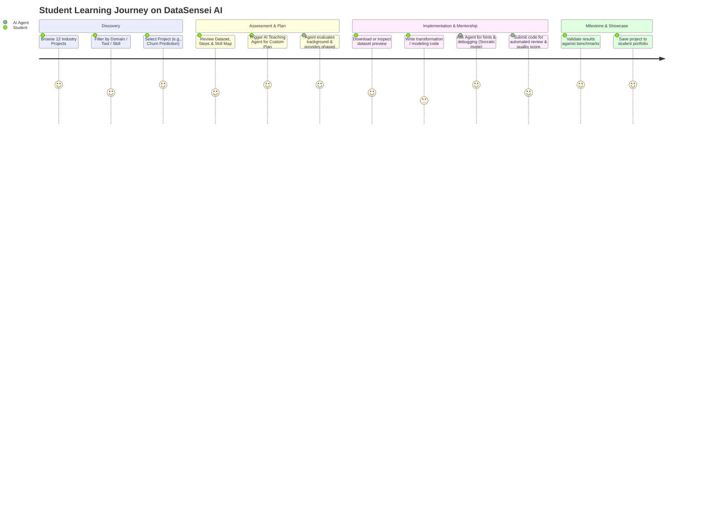
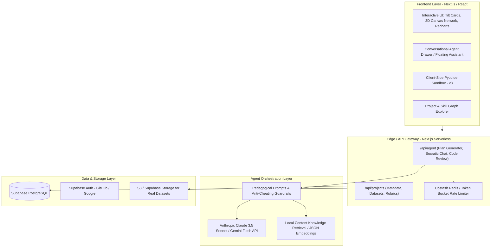
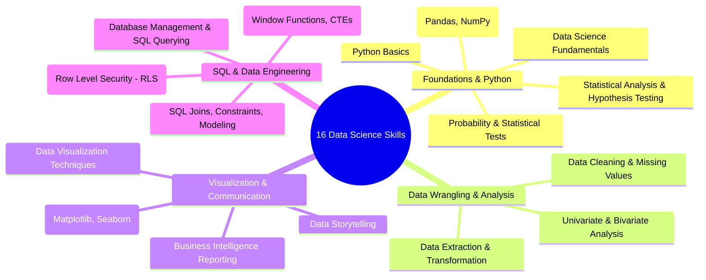
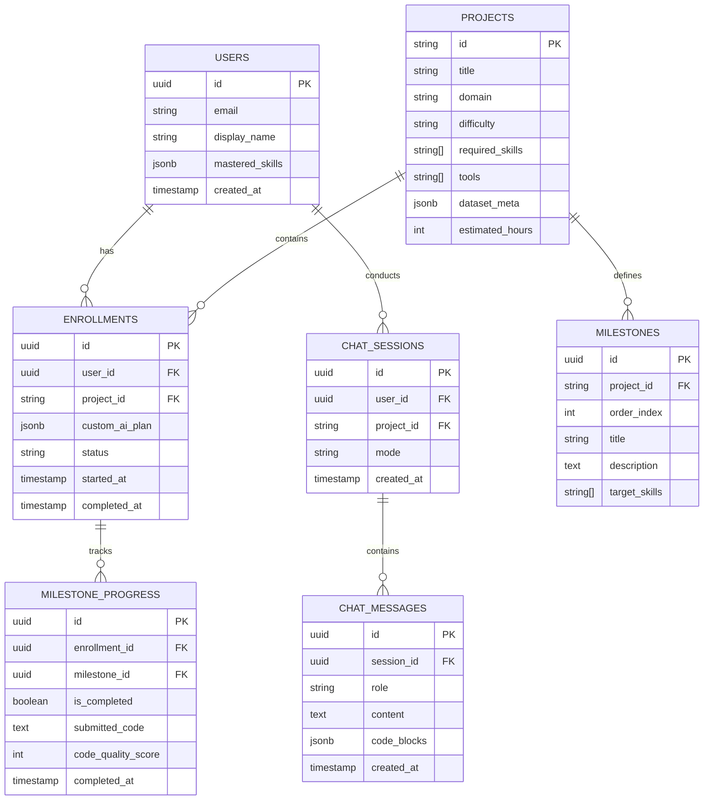

# Product Requirement Document (PRD)
# Project: DataSensei AI – Adaptive Data Science Teaching Agent Platform

**Document Version:** 1.0.0  
**Status:** Approved / In Progress  
**Author / Team:** DataSensei AI Core Engineering & Product Team  
**Last Updated:** October 2026  
**Target Release:** v1 (MVP) -> v2 (Intelligent Agent) -> v3 (Interactive Studio)

---

## 1. Executive Summary & Product Vision

### 1.1 Problem Statement
Learning Data Science is notoriously fragmented. Aspiring learners, students, and transitioning developers face:
1. **Tutorial Purgatory:** Endless consumption of theoretical videos with zero real-world project scaffolding.
2. **Disconnected Tech Stacks:** Confusion connecting foundational skills (e.g., SQL window functions, statistical hypothesis testing) to modern industry tools (e.g., PyTorch, Hugging Face, XGBoost, Supabase RLS).
3. **Absence of Personalized 1-on-1 Mentorship:** When learners get stuck on data cleaning, debugging pandas pipelines, or choosing evaluation metrics, they either rely on general-purpose chat bots that give away the full code without teaching, or give up entirely.

### 1.2 Product Vision
**DataSensei AI** is an intelligent, problem-first Data Science learning platform anchored by an adaptive **Teaching AI Agent**. Instead of generic lectures, learners select real-world industrial business problems (churn, fraud, forecasting, RLS dashboards), explore datasets, understand prerequisite skills and tooling, and collaborate with an AI mentor that creates customized learning plans, conducts code reviews, provides Socratic debugging, and guides them from raw data to production MLOps.

### 1.3 Value Proposition
- **Problem-Driven Learning:** Choose from 12 flagship industry projects spanning 8 domains (BI, Predictive Modeling, A/B Testing, NLP, Computer Vision, Forecasting, Data Engineering, MLOps).
- **Curated 16-Skill & 15-Tool Matrix:** Clear mapping showing *why* and *where* each skill and tool is applied.
- **Socratic AI Teaching Mentor:** Not a passive code dispenser, but an active pedagogical agent that assesses current skill levels, generates tailored roadmaps, gives progressive hints, and reviews code quality.

---

## 2. Target Personas & User Journeys

### 2.1 Personas

| Persona | Background & Goals | Pain Points | Desired Outcome from DataSensei AI |
|---|---|---|---|
| **P1: "The Aspiring Career Transitioner"** | Junior software engineer or business analyst transitioning into Data Science / ML. | Knows Python or SQL, but struggles with statistical rigor, ML project lifecycle, and building an industry-grade portfolio. | Structured, project-first roadmap that connects their existing strengths to missing ML/Ops skills. |
| **P2: "The STEM Student"** | Undergraduate / Master's student in CS, Math, or Engineering. | Understands theoretical math and algorithms, but lacks experience with messy, real-world data pipelines and business metrics. | Hands-on experience with real datasets, data cleaning, and production deployment scenarios. |
| **P3: "The Upskilling Practitioner"** | Data Analyst aiming to become an Analytics Engineer or ML Engineer. | Needs to learn advanced SQL (CTEs, Window Functions), Row Level Security (RLS), and modern NLP/LLM frameworks. | Targeted, modular projects focusing on specific gaps (e.g., BI + RLS, Sentiment with Hugging Face). |

### 2.2 Core User Journey (End-to-End)



---

## 3. Goals & Success Metrics (KPIs)

### 3.1 Primary Success Metrics (North Star)
- **Project Milestone Completion Rate (PMCR):** Percentage of users who initiate a project and successfully complete all milestone deliverables with AI mentoring. Target: > 45% (industry benchmark for self-paced MOOCs is < 10%).

### 3.2 Product & Pedagogical Metrics

| Category | Metric | Baseline / Target | Measurement Method |
|---|---|---|---|
| **Engagement** | Weekly Active Learners (WAL) | 1,000 active learners within 60 days of v2 launch | Supabase Auth + Session Telemetry |
| **Agent Helpfulness** | Helpful Answer Rating (CSAT) | ≥ 88% positive thumbs-up on Agent responses | In-chat feedback widget |
| **Socratic Effectiveness** | Hint-to-Solution Ratio | ≥ 70% of learners resolve code blocks using hints rather than asking for full solutions | AI interaction telemetry |
| **Retention** | 30-Day Project Retention | ≥ 35% repeat project starts | Product analytics |
| **System Performance** | Agent Response Time (TTFT) | < 800ms Time-To-First-Token | Server-side streaming metrics |

---

## 4. System Architecture & Tech Stack

### 4.1 High-Level Architecture Diagram



### 4.2 Technology Stack

| Layer | Component | Choice | Rationale |
|---|---|---|---|
| **Frontend Framework** | Web Application | Next.js 14+ (App Router), React, TypeScript | SSR/SSG for SEO, rapid server actions, clean modularity |
| **Styling & 3D** | UI & Visual Design | Vanilla CSS / Tailored CSS Modules, Three.js (Canvas Network), Recharts | High-performance 3D visual graph, fluid animations, dynamic data charts without bulky CSS overhead |
| **Agent / LLM API** | Core Intelligence | Claude 3.5 Sonnet / Gemini 1.5 Pro | Superior reasoning in code analysis, multi-step planning, and pedagogical nuance |
| **API Backend** | Serverless Endpoints | Next.js API Routes (Node.js / Edge) | Unified codebase, zero-cold-start edge execution for streaming agent tokens |
| **Database & Auth** | Persistence | Supabase (PostgreSQL with Row Level Security) | Native RLS, built-in Auth, instant vector storage capability for future RAG |
| **Code Execution (v3)** | In-Browser Sandbox | Pyodide (WebAssembly Python) | Runs NumPy, Pandas, Scipy directly in user's browser with zero server computing cost |

---

## 5. Domain Knowledge Matrix: Skills, Tools & Industry Tracks

DataSensei AI is grounded in a taxonomy of **16 Core Skills**, **15 Industry Tools**, **8 Industry Tracks**, and **12 Flagship Projects**.

### 5.1 The 16 Core Skills



### 5.2 The 15 Core Tools
1. **Python:** Core programming language.
2. **Jupyter Notebook:** Interactive computing and exploration.
3. **Pandas:** Tabular data wrangling and transformation.
4. **NumPy:** Vectorized numerical operations and linear algebra.
5. **Matplotlib:** Low-level plotting and chart generation.
6. **Seaborn:** High-level statistical visualization.
7. **SciPy:** Advanced scientific algorithms and statistical distributions.
8. **Scikit-Learn:** Core machine learning algorithms (classification, regression, clustering).
9. **XGBoost:** Gradient boosted decision trees for tabular benchmarks.
10. **TensorFlow:** Deep learning framework for large-scale computation.
11. **Keras:** High-level neural network API.
12. **PyTorch:** Modern dynamic deep learning framework for computer vision and LLMs.
13. **Hugging Face:** Pre-trained transformer models and NLP pipelines.
14. **spaCy:** Production-grade industrial NLP and tokenization.
15. **Google Colab:** Cloud GPU/TPU notebook environment.

### 5.3 The 8 Industry Work Types
1. **BI & Analytics:** KPI dashboards, cohort retention, executive reporting.
2. **Predictive Modeling:** Tabular classification, regression, risk scoring.
3. **Experimentation (A/B Testing):** Power analysis, hypothesis testing, uplift modeling.
4. **Natural Language Processing (NLP):** Sentiment analysis, topic modeling, embeddings, LLM prompting.
5. **Computer Vision:** Image classification, object recognition, visual inspection.
6. **Forecasting & Time Series:** ARIMA, Prophet, seasonal decomposition, demand planning.
7. **Data Engineering:** ETL pipelines, SQL modeling, schema validation, RLS policies.
8. **MLOps:** Model monitoring, data drift, model registry, containerized inference.

### 5.4 The 12 Flagship Projects Matrix

| # | Project Name | Domain / Track | Key Skills Applied | Tools Used | Dataset Source / Specs | Deliverable |
|---|---|---|---|---|---|---|
| 1 | **Customer Churn Prediction** | Predictive Modeling | Data Cleaning, Univariate/Bivariate, Classification, Feature Eng | Pandas, Scikit-Learn, Seaborn, XGBoost | Telco Churn (7,043 rows, 21 features) | Churn model + feature importance report |
| 2 | **Credit Card Fraud Detection** | Predictive Modeling | Class Imbalance (SMOTE), Probability Tests, Precision-Recall | Pandas, Scipy, Scikit-Learn, XGBoost | Kaggle Credit Card (284k transactions, PCA features) | High-recall fraud scoring pipeline |
| 3 | **Retail Demand & Sales Forecasting** | Forecasting | Time Series, Trend/Seasonality, Advanced SQL | Python, Pandas, Matplotlib, SciPy, Advanced SQL | Walmart Store Sales (143k records, weekly timestamps) | 12-week forward forecast + error bounds |
| 4 | **Customer Sentiment Analysis** | NLP | Text Preprocessing, Embeddings, Transformer Fine-tuning | NLTK, spaCy, Hugging Face, PyTorch | Amazon Product Reviews (50k balanced reviews) | Sentiment classifier + aspect-based extractor |
| 5 | **Medical Imaging Classifier** | Computer Vision | CNN Architectures, Data Augmentation, Transfer Learning | PyTorch, Keras, TensorFlow, Colab | Chest X-Ray / Pneumonia (5,863 JPEG images) | Binary classifier with Grad-CAM visualizer |
| 6 | **E-Commerce Hybrid Recommendation** | Predictive / RecSys | Matrix Factorization, Cosine Similarity, Collaborative Filtering | Pandas, SciPy, Scikit-Learn, PyTorch | MovieLens / E-Commerce Clickstream (100k ratings) | Top-N personalized recommendation engine |
| 7 | **Real Estate Price Valuation** | Predictive Modeling | Regression Metrics, Outlier Detection, Multicollinearity (VIF) | Pandas, NumPy, Scikit-Learn, Matplotlib | Ames Housing Dataset (79 exploratory variables) | Regularized regression model (Ridge/Lasso) |
| 8 | **A/B Conversion Rate Test** | Experimentation | Hypothesis Testing, Z-test, T-test, P-value calculation, Sample Size | SciPy, Statsmodels, Pandas, Seaborn | E-commerce Landing Page A/B Test (45k visitors) | Executive decision memo + statistical confidence analysis |
| 9 | **Executive BI Dashboard & RLS** | BI & Data Eng | Advanced SQL (CTEs, Window), RLS Policies, Data Storytelling | PostgreSQL, Supabase, Metabase / Recharts | SaaS Multi-tenant Subscription Data | Multi-tenant dashboard respecting tenant isolation |
| 10 | **Automated Data Cleaning Pipeline** | Data Engineering | Missing Values Imputation, Schema Validation, Outlier Handling | Python, Pandas, NumPy, SQL Constraints | Raw Dirty Public Hospital Records | Reusable automated validation & cleaning module |
| 11 | **IoT Predictive Maintenance** | Predictive / MLOps | Sensor Telemetry, Rolling Aggregations, Survival Analysis | Pandas, XGBoost, Scikit-Learn, Matplotlib | NASA Turbofan Engine Degradation (sensor telemetry) | Remaining Useful Life (RUL) estimator |
| 12 | **Customer Segmentation & RFM** | BI & Analytics | K-Means, Elbow Method, Silhouette Score, RFM Analysis | Pandas, Scikit-Learn, Seaborn, Matplotlib | Online Retail II UCI Dataset (541k transactions) | Interactive RFM clusters + marketing persona deck |

---

## 6. The Teaching AI Agent Specification (Core Engine)

The Teaching AI Agent is the intellectual heart of DataSensei AI. Unlike generic chatbots, it operates under an explicit pedagogical framework.

### 6.1 The 6 Agent Roles

```
┌───────────────────────────────────────────────────────────────────┐
│                    TEACHING AI AGENT ENGINE                       │
├─────────────────┬───────────────────┬─────────────────────────────┤
│ 1. Plan         │ 2. Socratic       │ 3. Code Review &            │
│    Architect    │    Debugger       │    Quality Coach            │
│ (Customized     │ (Multi-tier hints │ (PEP 8, vectorized syntax,  │
│  step-by-step   │  without giving   │  algorithmic complexity,    │
│  study paths)   │  away code)       │  data leakage checks)       │
├─────────────────┼───────────────────┼─────────────────────────────┤
│ 4. Repetitive   │ 5. Feature        │ 6. Continuous Learner       │
│    Task Helper  │    Integrator     │    & Progress Tracker       │
│ (Scaffolding    │ (Seamless tools & │ (Adapts difficulty based    │
│  boilerplate,   │  dataset linking, │  on learner submissions &   │
│  regex, schema) │  API guidance)    │  historical quiz scores)    │
└─────────────────┴───────────────────┴─────────────────────────────┘
```

1. **Plan Architect:** Ingests the student's background, available hours per week, and chosen project; synthesizes a personalized 4-phase milestone plan mapped to the 16 skills.
2. **Socratic Debugger:** When a student pastes a traceback (e.g., `KeyError`, `SettingWithCopyWarning`, `ConvergenceWarning`), the agent guides them to identify the root cause rather than immediately spitting out the fix.
3. **Code Review & Quality Coach:** Analyzes student code for:
   - Data leakage (e.g., fitting scaler on test set before train-test split).
   - Inefficient loops where vectorized Pandas / NumPy should be used.
   - Code readability, docstrings, and adherence to PEP 8 standards.
4. **Repetitive Task Helper:** Assists with boilerplate tasks like generating synthetic dirty data for testing or generating starter SQL schemas so the student stays focused on high-order reasoning.
5. **Feature Integrator:** Dynamically pulls information from the platform's JSON catalog (project datasets, prerequisites, tool versions) into context.
6. **Continuous Learner & Progress Tracker:** Monitors milestone completion and flags foundational skill gaps (e.g., if a student struggles with `XGBoost` hyperparameters, the agent suggests revisiting `Bivariate Analysis` or `Decision Trees`).

### 6.2 Agent Prompting & Pedagogical System Instructions

```markdown
You are DataSensei Mentor, an expert Data Science and Machine Learning teaching agent.
Your mission is to guide learners to achieve deep mastery through project-based learning.

PEDAGOGICAL PRINCIPLES:
1. Socratic First: Never immediately provide the complete solution code unless explicitly asked after 3 progressive hints.
   - Level 1 Hint: Conceptual explanation of what the error or step requires.
   - Level 2 Hint: Pseudo-code or library function signature (e.g., "Look into pd.merge with how='left'").
   - Level 3 Hint: Targeted snippet highlighting the specific fix.
2. Anti-Data Leakage Watchdog: Always verify that transformations are fit ONLY on training sets.
3. Industry Context: Explain *why* a technique is favored in enterprise settings (e.g., why AUC-ROC is preferred over Accuracy for imbalanced fraud data).
4. Code Standards: Encourage vectorization over `.iterrows()`, proper random seeds, and modular functions.
```

### 6.3 Agent API Specifications

#### Endpoint 1: Generate Custom Learning Plan
- **Route:** `POST /api/agent/generate-plan`
- **Request Payload:**
```json
{
  "projectId": "churn-prediction",
  "studentLevel": "intermediate",
  "weeklyHours": 6,
  "knownSkills": ["python-basics", "sql-querying"],
  "targetGoal": "Portfolio ready project for junior ML engineer role"
}
```
- **Response Payload (Streaming or JSON):**
```json
{
  "planId": "plan_98234",
  "totalWeeks": 3,
  "phases": [
    {
      "phaseIndex": 1,
      "title": "Data Audit & Exploratory Data Analysis (EDA)",
      "skillsRequired": ["Data Cleaning", "Univariate & Bivariate Analysis"],
      "tools": ["pandas", "seaborn"],
      "deliverables": ["Interactive EDA notebook", "Missing value report"]
    },
    {
      "phaseIndex": 2,
      "title": "Feature Engineering & Preprocessing Pipeline",
      "skillsRequired": ["Data Extraction & Transformation"],
      "tools": ["scikit-learn", "numpy"],
      "deliverables": ["ColumnTransformer pipeline without leakage"]
    },
    {
      "phaseIndex": 3,
      "title": "Model Training, Tuning & Evaluation",
      "skillsRequired": ["Statistical Tests", "Predictive Modeling"],
      "tools": ["xgboost", "scikit-learn", "matplotlib"],
      "deliverables": ["Tuned model achieving ROC-AUC > 0.84", "SHAP feature attribution plot"]
    }
  ]
}
```

#### Endpoint 2: Socratic Mentorship & Code Review
- **Route:** `POST /api/agent/chat`
- **Request Payload:**
```json
{
  "conversationId": "conv_4821",
  "projectId": "churn-prediction",
  "currentMilestone": "phase_2",
  "userMessage": "My model has 98% accuracy on churn, but my recall is only 0.12. What happened?",
  "codeSnippet": "clf = RandomForestClassifier().fit(X_train, y_train)\nprint(accuracy_score(y_test, clf.predict(X_test)))",
  "interactionMode": "socratic_hint"
}
```
- **Response Format:** Server-Sent Events (SSE) streaming Markdown response with token-by-token rendering and interactive hint disclosure toggles.

---

## 7. Functional Requirements (FRD)

The requirements are prioritized using the MoSCoW framework (**M**ust have, **S**hould have, **C**ould have, **W**on't have for now).

### Epic 1: Project Catalog & Skill Network Explorer
- **FR-1.1 [Must Have]:** The platform must display a grid/list of the 12 Flagship Projects with filtering by:
  - Industry Work Type (8 tracks)
  - Tool (15 tools)
  - Core Skill (16 skills)
  - Difficulty Level (Beginner, Intermediate, Advanced)
- **FR-1.2 [Must Have]:** Each project card must display estimated completion time, dataset size, frequency in industry, and key deliverables.
- **FR-1.3 [Should Have]:** Interactive 3D/2D Visual Skill Graph showing nodes (skills/tools) and edges connecting them to projects. Clicking a node filters the projects that utilize that node.
- **FR-1.4 [Must Have]:** Project Detail View providing:
  - Problem overview and business impact
  - Dataset schema, preview rows, and statistics
  - Step-by-step milestone checklist
  - Direct trigger button to launch the AI Teaching Agent

### Epic 2: AI Teaching Agent & Chat Drawer
- **FR-2.1 [Must Have]:** A responsive chat drawer accessible across all project views, maintaining context of the active project and user's current milestone.
- **FR-2.2 [Must Have]:** **Custom Plan Generator:** Modal questionnaire collecting student background and generating a tailored roadmap stored in user session or database.
- **FR-2.3 [Must Have]:** **Socratic Mode Toggle:** Users can switch between "Socratic Mentor" (hints and guided questions) and "Direct Explanation" mode.
- **FR-2.4 [Should Have]:** **Code Quality Checker:** A dedicated "Review My Code" action within the chat where the agent parses pasted code for vectorization, anti-leakage, and PEP 8 conformity.
- **FR-2.5 [Should Have]:** Syntax-highlighted code blocks with a one-click "Copy Code" and "Explain Step-by-Step" button.

### Epic 3: Dataset Explorer & Live Stats
- **FR-3.1 [Must Have]:** In-browser tabular preview for project datasets (first 50 rows, pagination, column data types).
- **FR-3.2 [Should Have]:** Live summary statistics (mean, median, standard deviation, missing values count, distribution histograms) rendered via Recharts.
- **FR-3.3 [Could Have]:** Direct "Open in Google Colab" notebook generator with starter code and pre-loaded dataset URLs.

### Epic 4: User Progress & Portfolio (v2)
- **FR-4.1 [Must Have]:** Supabase authentication supporting GitHub, Google, and Email magic links.
- **FR-4.2 [Must Have]:** Milestone checklist state persistence per user (checkbox state saved to PostgreSQL).
- **FR-4.3 [Should Have]:** Skill Progress Radar Chart displaying the user's acquired mastery across the 16 core skills as they mark project deliverables complete.

### Epic 5: In-Browser Code Runner (v3)
- **FR-5.1 [Could Have]:** Embedded Pyodide WebAssembly execution environment allowing learners to run Pandas, NumPy, and Scikit-Learn code directly in the browser without server compute.
- **FR-5.2 [Could Have]:** Automated unit tests running against student code in Pyodide to validate milestone deliverables automatically.

---

## 8. Non-Functional Requirements (NFRs)

### 8.1 Performance & Latency
- **Time to First Token (TTFT):** AI Agent streaming responses must initiate within ≤ 800ms under standard network conditions.
- **Page Load Speed:** Initial page load (LCP) ≤ 1.8s; client-side bundle size ≤ 200KB initial JS (excluding optional 3D canvas libraries loaded asynchronously).
- **Dataset Rendering:** Dataset table rendering must handle 10,000 in-memory rows via virtual scrolling (`react-window` or `@tanstack/react-virtual`) without UI freezing.

### 8.2 Security, Privacy & Safety
- **Row Level Security (RLS):** All user progress, custom plans, and chat logs stored in Supabase must enforce strict RLS policies: users can only read and write their own records.
- **API Key Protection:** LLM provider keys (Anthropic / Gemini) must remain strictly server-side in protected environment variables.
- **Rate Limiting:** Protect `/api/agent/*` endpoints via token bucket algorithm (e.g., maximum 30 agent requests per minute per authenticated user; 5 per minute for unauthenticated guest sessions).
- **Prompt Injection Defense:** Strict input sanitization and delimiter bounding to prevent prompt jailbreaks from altering the pedagogical persona.

### 8.3 Reliability & Availability
- **System Uptime:** 99.9% uptime target for the core static catalog and dataset viewer.
- **Graceful LLM Degradation:** If the upstream LLM API returns an error or timeout, the agent drawer must display a friendly fallback message with pre-computed FAQs and retry options.

### 8.4 Usability & Accessibility (a11y)
- **WCAG 2.1 AA Compliance:** Minimum 4.5:1 color contrast ratio across dark and light modes.
- **Keyboard Navigation:** All interactive cards, modal dialogs, and chat inputs must be 100% accessible via keyboard (`Tab`, `Esc`, `Enter`).
- **Mobile Responsiveness:** Fluid layout supporting screens from 360px mobile viewports to 4K ultra-wide monitors.

---

## 9. Data Models & Database Schema (Supabase / PostgreSQL)



---

## 10. Phased Roadmap & Release Milestones

### Phase 1: MVP (v1) – Interactive Learning Portal & Scaffolding
- [x] Comprehensive catalog with 12 industry projects, 16 skills, and 15 tools.
- [x] Client-side search, domain filtering, and skill tags.
- [x] Static dataset schemas, preview cards, and milestone breakdown.
- [x] Rule-based or mock Agent UI demonstrating plan generation and sample hints.
- [x] Dark-mode first, glassmorphism UI with smooth interactions and responsive design.

### Phase 2: Intelligent Platform (v2) – LLM Agent & Supabase Backend
- [ ] Connect Claude 3.5 Sonnet / Gemini API via Next.js Edge streaming routes.
- [ ] Implement custom plan generation based on interactive questionnaire.
- [ ] Deploy Socratic hint engine and code review evaluator with prompt guardrails.
- [ ] Supabase PostgreSQL database integration with Auth (GitHub/Google) and Row Level Security.
- [ ] Real dataset integration: direct CSV/Parquet downloads and dynamic in-browser summary statistics.
- [ ] User dashboard tracking project milestone completion and personal skill radar chart.

### Phase 3: Interactive Studio (v3) – Browser Sandboxes & Certifications
- [ ] In-browser WebAssembly Python execution via Pyodide (Pandas/Scikit-Learn).
- [ ] Automated code validation test-suites assessing learner deliverables in real-time.
- [ ] Interactive skill tree / graph view with node unlock mechanics.
- [ ] Verified certificate of project completion with shareable public portfolio link.
- [ ] Community discussion threads and peer review system per project.

---

## 11. Risks, Assumptions & Mitigation Strategies

| Risk / Challenge | Impact | Probability | Mitigation Strategy |
|---|---|---|---|
| **High LLM Token Costs** | High | Medium | Implement aggressive prompt caching, client-side rate limiting, context window truncation, and use lightweight models (Gemini Flash) for simple hints, reserving Claude 3.5 Sonnet for deep code reviews. |
| **Learner "Cheat Prompting"** | Medium | High | System prompt strictly enforces Socratic guidance and withholds copy-paste solutions unless explicit failure thresholds are met. |
| **Browser Out-of-Memory with Pyodide (v3)** | High | Medium | Enforce strict dataset downsampling (max 5MB in-memory tables for browser sandbox); provide "Open in Colab" fallback for heavy deep learning projects. |
| **Dataset API Breakages / Stale Links** | Medium | Low | Host standardized snapshots of public benchmark datasets (Telco, Kaggle, NASA) on dedicated Cloud Storage / Supabase Storage buckets. |

---

## 12. Acceptance Criteria & Sign-off Checklist

To deem the Teaching AI Agent & DataSensei AI platform ready for production release, the following criteria must be satisfied:

- [ ] **Catalog Completeness:** All 12 flagship projects accurately cross-reference their specific subsets of the 16 skills and 15 tools.
- [ ] **Agent Responsiveness:** The agent chat responds with streaming markdown and code blocks with TTFT < 800ms.
- [ ] **Pedagogical Alignment:** When asked "Give me the answer to step 2", the agent answers with clarifying questions or Level 1 hints rather than raw code.
- [ ] **Plan Generator Accuracy:** Generating a customized plan adapts the timeline and step complexity depending on whether the user selects "Beginner" (30 hours) or "Advanced" (10 hours).
- [ ] **Data Security:** No raw API keys exposed on client side; all database queries adhere to Supabase Row Level Security.
- [ ] **Cross-Device Usability:** Complete end-to-end user journey functions seamlessly on Chrome, Firefox, Safari, and Mobile browsers.
